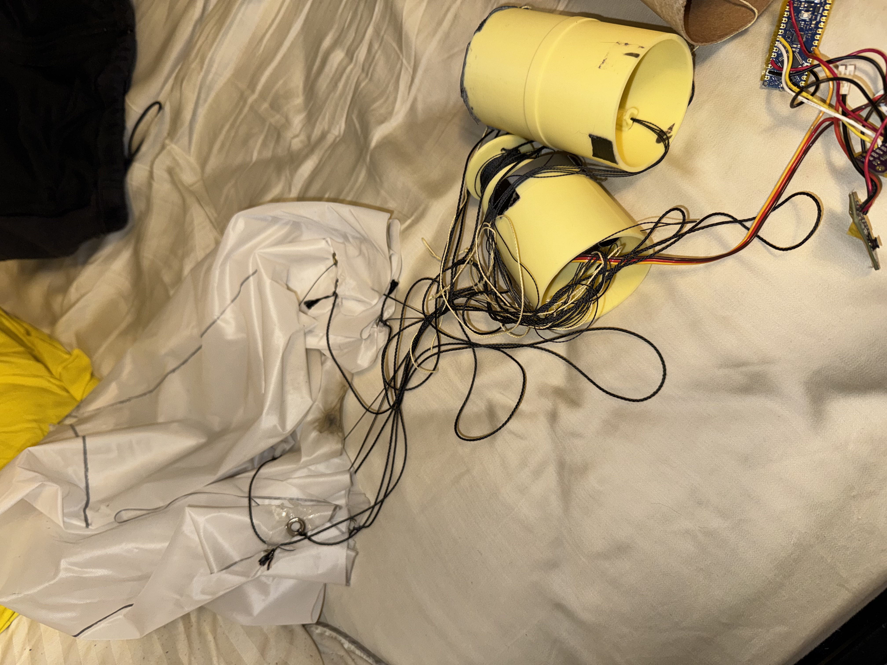

# What to do next?

We had our successful launch. The ARC specifications have come out and are very similar to last year, with some changes to the body tube diameter requirements, two eggs instead of 1, and a 50ft bump to apogee. Nothing crazy, meaning our current design for apogee control should work well. The main challenge will be somehow combining descent control AND ascent control into one grandiose design that will perfectly qualify for nationals. The main issue, of course, is cable management with the descent control:

And also the weight. The ARC ascent-control design was barely under the 650g weight cap, and our current reefing project was also in the 600g range. Though a lot of the mass is overlapped (same majority of electronics, motor, 3D printed parts, etc...), there are also unique parts like the humongous 35kg/cm servo that weighs 70 grams on its own. Combining these two electronically controlled designs into one will be excruciatingly difficult, but I believe it can be done. 

I wish us luck next year and I hope to revisit this documentation soon!

