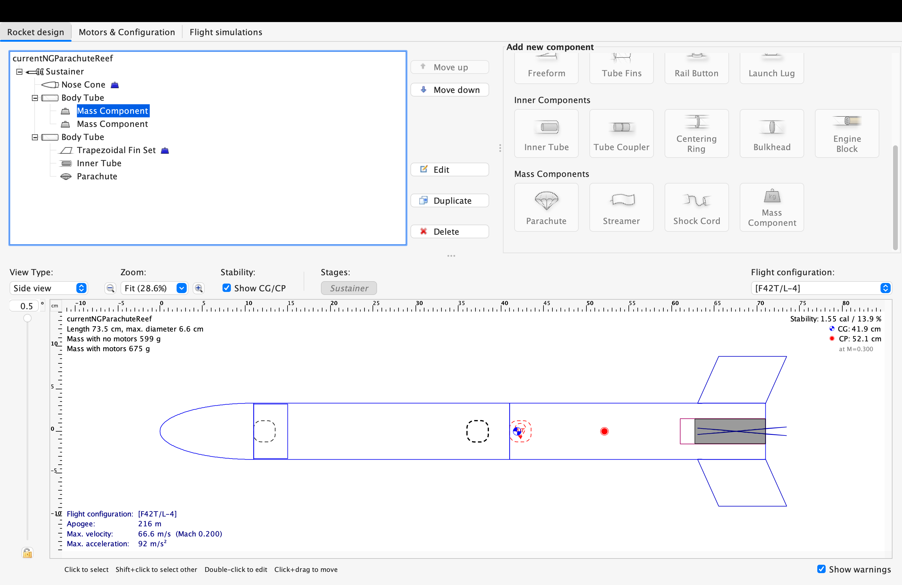
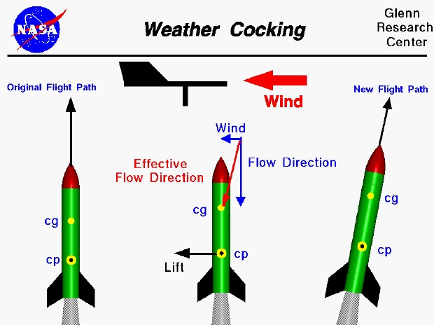
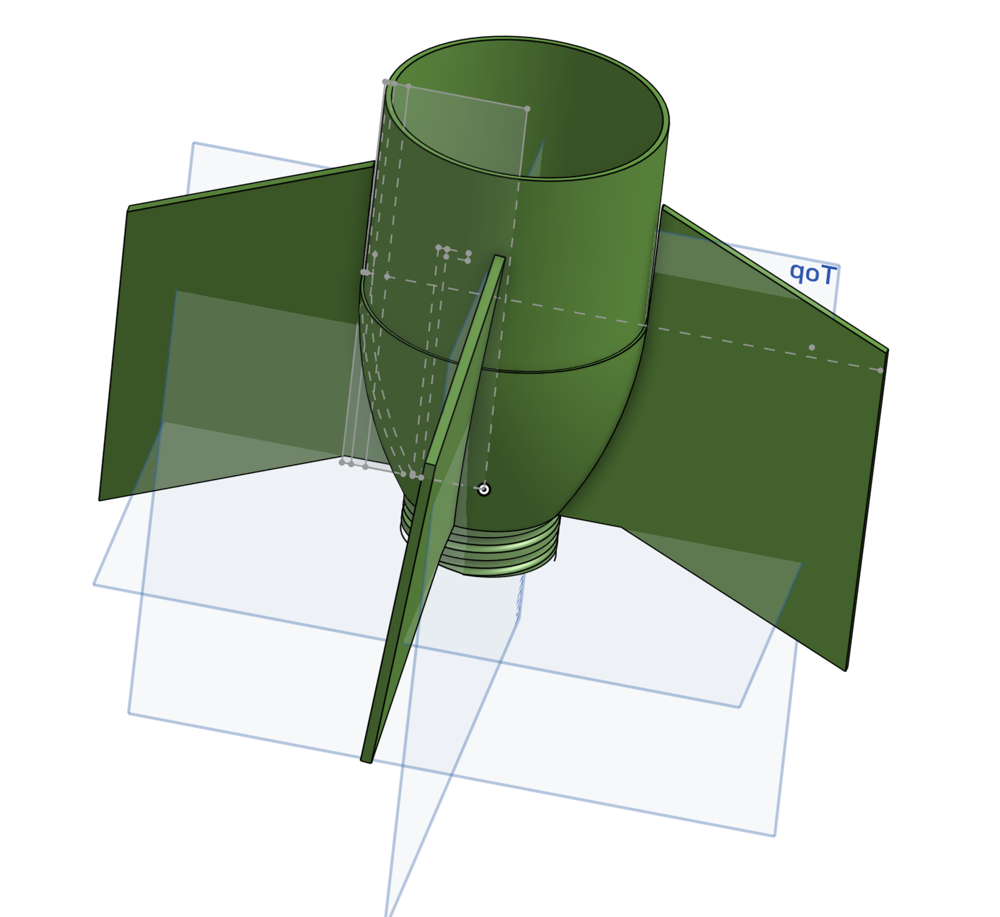
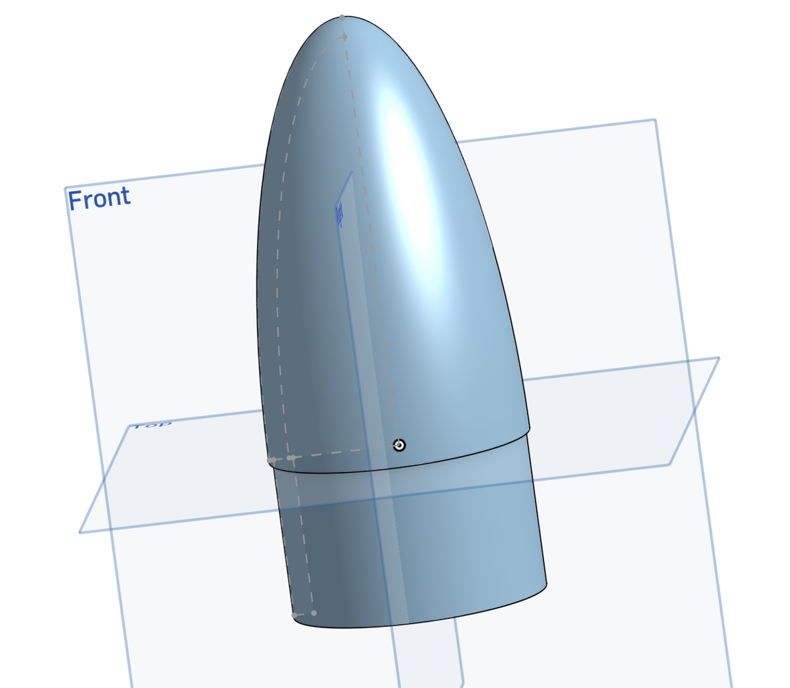
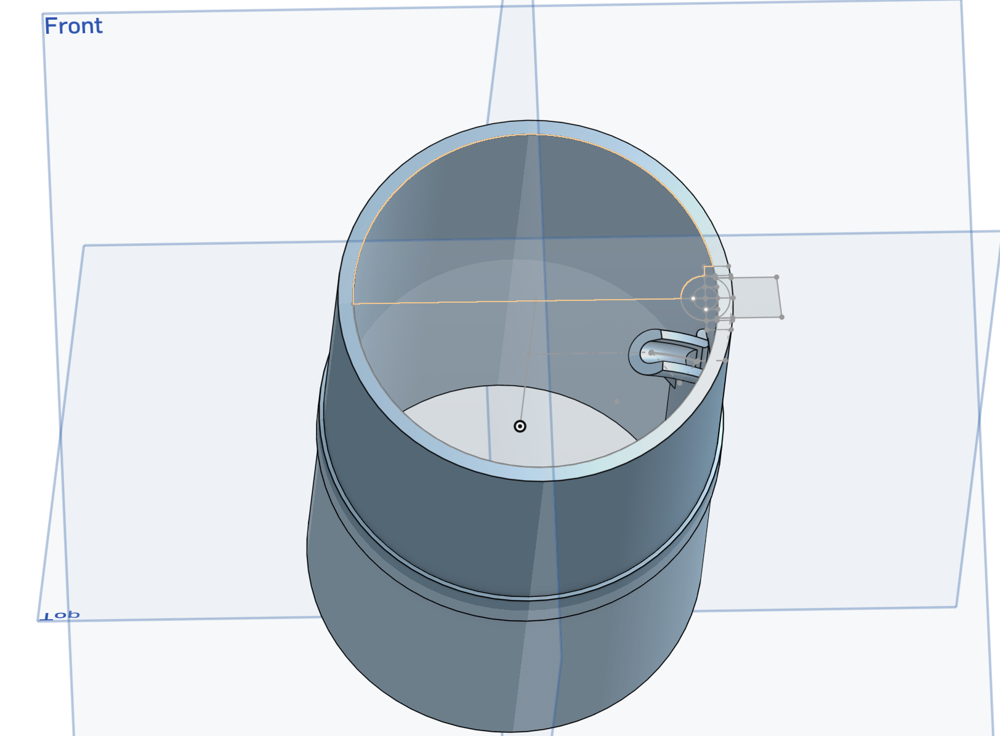
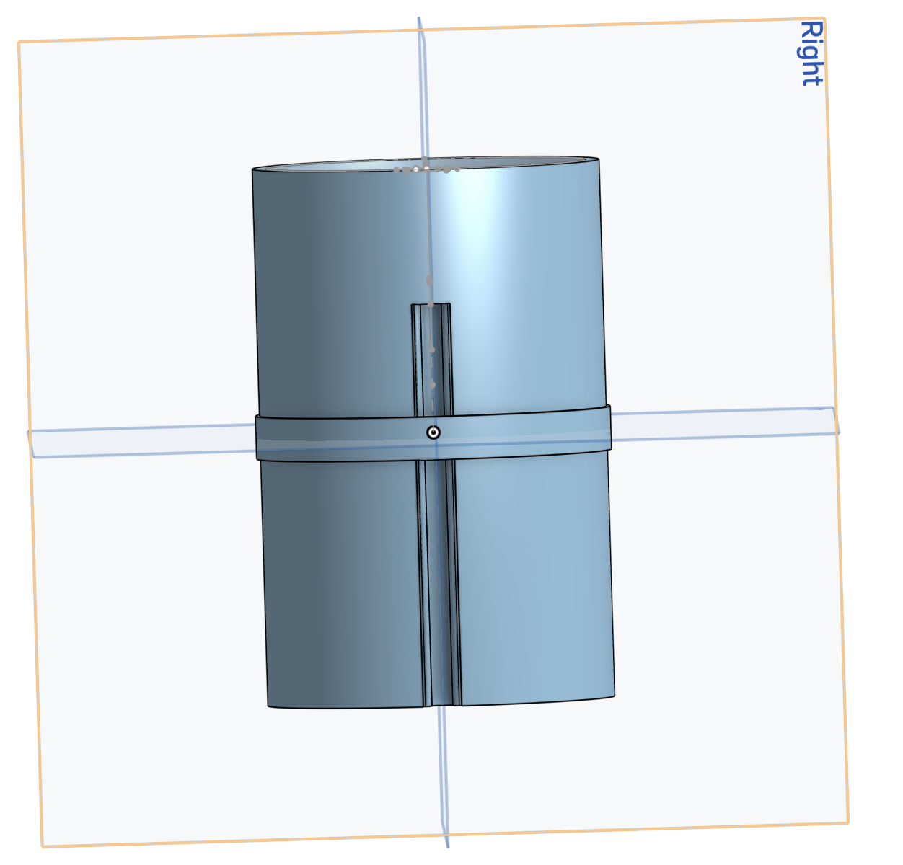
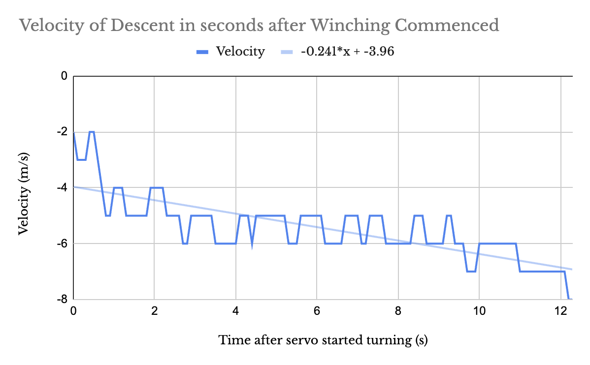

# Progress Report #3 (final!)
We have decided to bite the bullet and construct an entire rocket to test the effectiveness of the reefing design. It would have been much more preferred to use a small-scale prototype, but with significant time constraints (my teammate’s college departure, who's coding has been critical to this project) production has been rushed to making a full rocket with the integrated reefing mechanism. The first step in the construction of this rocket, as always, is to plug in basic parameters into the software OpenRocket, which will calculate/approximate basic stability and apogee details. 

The most crucial details when designing a basic rocket like this are the weights of individual components (fins, nose cone, ‘mass component’ in the center to represent avionics, etc) and then match them as closely as possible in the real world. This can be achieved through modifying infill and print material with FDM printing. 

The aerodynamic stability of the rocket, measured in calibers, is approximately 1.52, which is considered well within the ‘sweet spot’ of 1-2 calibers for model rockets to both remain . This value simply measures how many rocket body (body tube) diameters the center of gravity is ahead of the center of pressure. This value is important as it ensures the rocket won’t tumble due to being under stable or ‘weathercock’ (turn into the wind due to stability being too high). The intuitive explanation can be given through this NASA model rocketry diagram: 

    

It was quite simple to model all the corresponding parts that are associated with the OpenRocket - making a fin can with the same fin dimensions, a simple nose cone, etc. The body tube is one diameter continuous, that being BT-80 (66mm outer, 65mm inner diam) thus not requiring dubious levels of modeling for a transition piece between the two of them and matching two different diameters. The parts are always modeled with 0.05cm of wiggle room to account for thermal expansion.

Once the fin can was modeled, it was printed out of basic PLA and then epoxied onto the body tube, with one half of the shock cord attached to a drill hole within that fin can.

It can be noted that the transition looks quite unique, with a 'channel' running down the side and a small hook section that leans into the body of the rocket. This was done intentionally, so that the line of the shock cord would be less tangled with the parachute itself or associated shroud lines prior to the two halves separating from the ejection charge. It also allowed for us to mount the servo in a vertical fashion (with the axis of rotation being in line with the body tubes), as the dimensions of the servo would have made it difficult to fit in any other orientation. To make the string naturally collect on the spool due to gravity, this resulted in a requirement of horizontal feeding. The spool, naturally, has raised edges as to prevent the shock cord from slipping off during winching. 

Here is the progression of the various winch designs we tried before settling on the final circular design. Due to the size of the servo, the placement of the winch had to be slightly off-center (the drive shaft of the center is not centered, and the servo could not be fit into the BT80 in such a way to make it as such). 

I also soldered a simple circuit for this. It has very similar components to our earier "Superova" project. It includes the Arduino Nano Every, the Verter 3-5V Buck Boost (required for the LiPo that provides 3.7V to the operating voltage of 5V on the Nano), 2200 microfarad capacitor (for the servo to not cause severe supply voltage drop from current spike), the classic BMP390 barometric pressure sensor for altitude/velocity/acceleration calculations, and the aforementioned 3.7V LiPO (2000mAh). We also used a small piece of a breadboard in order to wire all of these connections together instead of using wired junctions, as there have been incidents in the past where these connections fail or are difficult to add new components to. It is important to note that an SD reader was not used this time, considered unneeded, so all flight data had to be stored on the on-board EEPROM. For the Nano this is a ridiculously small 256 BYTES, meaning all non-essential information must not be tracked. This meant we only tracked the rockets velocity immediately following the start of the winching (during descent), and did not track altitude on the way up, deemed unecessary for this test. 

Finally, we had finished all essential parts of this project. A few days before the departure of my close friend, teammate, and lead programmer, on August 15th, we decided to perform a launch. 

We arrived onto the launch field in Acton, set up the launch rail, and loaded the program onto the Nano. 

This is crucial due to the drift that the barometric pressure sensor experiences. Additionally, it is best for the program to be started on the launch site, as the battery does not last forever and the initial temperature benchmark (done by the BMP) should be based on external temp instead of temp inside the car or other location. In short, the final software upload has become a ritual of our launches. 

And we're off! We set up the rocket on the launch rail, and counted down the seconds to ascertain the summers worth of work following our failure to qualify for ARC. 

*I apologize for the exclamations, I was quite excited to see this launch.*

Though it is difficult to tell from this video, it was far clearer in the field that the parachute slowly experienced radial contraction as the ratio of height of parachute to radius increased. 

I know this system worked because of the data collected on the aforementioned EEPROM data that was collected.

This graph shows that at the time of winching (the process by which the spool rotates) the speed of the rocket was around 2 m/s. To be noted, the rocket was coasting at around this speed for a while before. Then, following the winching, the rocket went up all the way to going between 5 and 6 m/s, for an average of 5.5 m/s. This is an increase of 175% in speed of descent, which is quite exceptional. I believe this to be quite an accomplishment and if implemented with Supernova could result in extremely competitive scores for ARC. 
