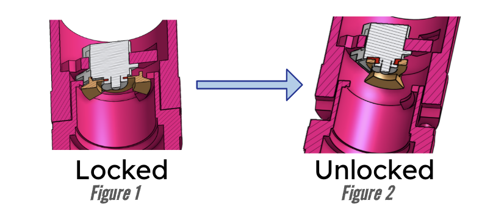
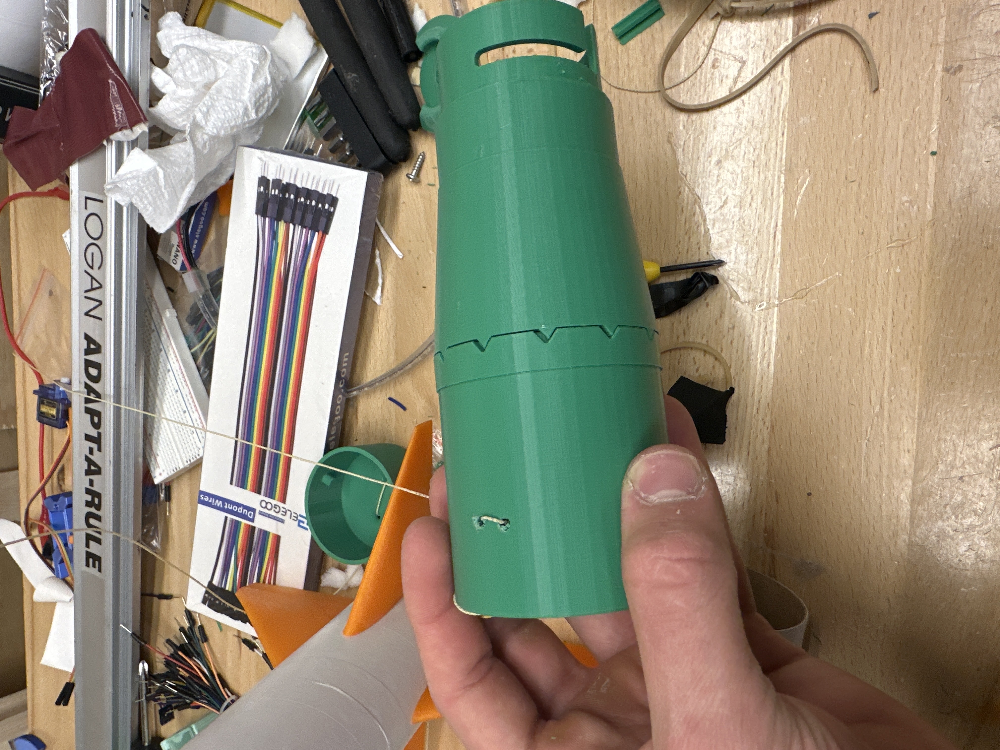

# Supernova Year 1 (2024-2025)

## A NOTE: This documentation was created following a year and a half of work, and thus some details are prone to being forgotten besides the information that is saved somewhere. This was not done while the project was ongoing.

This is the documentation for my first big project, Supernova.

Traditionally, the way that my aerospace club has attempted to qualify for ARC has been with the usage of a NG (non-guided) rocket. This means that all altitude control was decided before the rocket was in flight and was purely mass-based. In a vacuum, this idea works great! However, micro-adjustments in wind make huge impacts on rocket apogee, especially with the consistent weight requirement being around ~650g for ARC. One launch can be perfect, and without changing anything the next launch can garner 50 points (which for ARC is already far worse than qualifying standards of ~15 per launch, but preferably closer to 10.)

However, I have been told by older members of the club that they've also worked on guided rockets as side projects, yet never attempted to qualify with them. That the system wasn't reliable enough, and it would be better to gamble with a nonguided design and hope that the winds were favorable. But I didn't particularly like that. I wanted to try to qualify with a guided design because I felt that it was a waste of time to work on an electronically guided rocket and then immediately give up on it for competitions. 

So, I started brainstorming what I could do. Obviously, the rocket somehow needed a way to control its apogee actively, taking in information from some sort of sensor. But how would it control apogee? 

The previous years' guided designs had focused around air brakes, which would slide out horizontally from the body of the rocket in a petal-like formation in order to arrest the movement of the rocket. This seemed excruciatingly difficult to model and would likely have unprecedented stability issues. So, I thought the easier solution would be to take a page out of the drag racing book, and use a parachute to slow down the movement of the rocket. This would prove to be far more difficult than I initially thought, but was still likely easier aerodynamics-wise compared to air brakes.

Next came the issue of how to get a parachute out of the rocket. Typically, of course, the ejection charge built into the commercially-purchased motors separated the two halves of the rocket, but in order to control when we released the parachute there had to be some other way. An electronic way. From this, after weeks upon weeks of brainstorming, was the idea of the 'bowtie' mechanism thought up. 

*This is an image of the fundamental way this system works, though this image was taken after many many revisions of the original design*

This design means that when we needed to, we could separate the rocket into two halves. The latch would keep the rocket together, and once the rocket passed some threshold (we initially decided on a flat apogee value, but that would be changed later) it would rotate, allowing the two halves to drift apart.

Only after the first launch did we realize that wouldn't work. As is now obvious through Newton's Laws, nothing was pushing the two halves of the rocket apart (except a little bit of air pressure) which didn't work nearly quickly enough. So, we had to create another mechanism, this time to actively push the two halves of the rocket apart.

We settled on a design where a 3D-printed 'push rod' suspended by rubber bands would tension itself against the bowtie, and upon rotation would push the two halves of the rocket apart.

Additionally, to prevent the two halves of the transition from rotating against each other, we created teeth. However, those teeth were made to be triangular and equilateral, which allowed for them to slide slightly regardless.

Ultimately, this design worked alright, but a combination of worse code and poor physical mechanisms meant this design had little to no chances of qualifying. 

